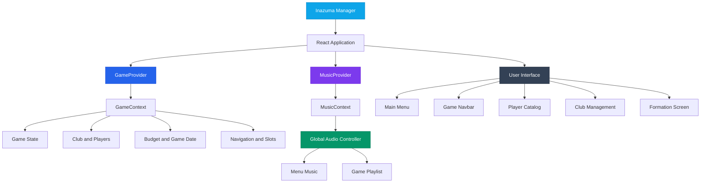

# ⚡ Inazuma Manager – Simulador de Gestión de Fútbol


**Inazuma Manager** es una aplicación web inspirada en el universo de *Inazuma Eleven*, desarrollada para ofrecer una experiencia de gestión futbolística en la que el jugador puede construir su propio club, fichar futbolistas, administrar su plantilla y organizar su equipo.

El proyecto combina una interfaz moderna con una ambientación inspirada en el universo de Inazuma Eleven, buscando trasladar la experiencia de un simulador de gestión deportiva a una aplicación web interactiva.

La aplicación está desarrollada con **React, Vite y Tailwind CSS**, utilizando una arquitectura basada en componentes reutilizables y un sistema de contexto para centralizar el estado de la partida.

---

## 🎯 Propósito del Proyecto

El objetivo de Inazuma Manager es desarrollar un simulador de gestión deportiva que permita al usuario tomar decisiones sobre la construcción y administración de su propio equipo.

La aplicación busca combinar tres pilares fundamentales:

- **Gestión deportiva:** creación y administración de un club, selección de entrenador y organización de la plantilla.
- **Mercado de fichajes:** exploración de jugadores, búsqueda de futbolistas y gestión de incorporaciones.
- **Experiencia inmersiva:** diseño visual inspirado en Inazuma Eleven, acompañado de música ambiental y una interfaz temática.

## 📐 Arquitectura del Sistema

Inazuma Manager utiliza una arquitectura basada en componentes de React, separando la interfaz visual, el estado global de la aplicación y las funcionalidades específicas de cada sección.

La gestión del estado se centraliza mediante **React Context**, permitiendo que diferentes componentes accedan a la información de la partida sin necesidad de transmitir propiedades manualmente a través de múltiples niveles.

Además, el sistema musical cuenta con un contexto independiente para centralizar la reproducción y sus controles.

### Diagrama de arquitectura



### Organización de la arquitectura

**1. Capa de presentación (UI Layer)**

Es la responsable de mostrar la información y permitir la interacción del usuario.

Se organiza mediante componentes reutilizables y pantallas independientes.

**2. Capa de estado y lógica (Context Layer)**

Centraliza los datos y las operaciones principales del juego.

- `GameContext`: gestiona el estado de la partida, la navegación, el club, los jugadores y la información económica.
- `MusicContext`: controla la reproducción musical y proporciona los controles de audio.

**3. Capa de recursos (Assets Layer)**

Contiene los recursos visuales y sonoros utilizados por la aplicación.

- Imágenes y recursos de jugadores.
- Archivos de audio.
- Iconografía.
- Elementos gráficos de la interfaz.

---

## 💻 Implementación Técnica

### ⚛️ Gestión del estado con React

Se utiliza React Context para centralizar la información de la aplicación y facilitar la comunicación entre componentes.

**GameContext:**

- Gestión de la pantalla actual.
- Control de la navegación entre secciones.
- Administración de los datos del club.
- Gestión del presupuesto.
- Control de la fecha de la partida.
- Acceso a la información de los jugadores.
- Gestión de los slots de partida.

**MusicContext:**

- Control centralizado de la reproducción.
- Gestión de la playlist.
- Control del volumen y silencio.
- Navegación entre canciones.
- Sincronización de la música con el estado de la aplicación.

### 🎨 Interfaz de Usuario

La interfaz está diseñada para mantener una identidad visual deportiva y tecnológica, inspirada en el universo de Inazuma Eleven.

**Tailwind CSS:**

Se utiliza para construir la interfaz mediante clases de utilidad, facilitando la creación de diseños flexibles y adaptables.

**Rajdhani:**

Se utiliza como tipografía de identidad para los encabezados, aportando una estética deportiva y futurista.

**Inter:**

Se utiliza para mejorar la legibilidad de los textos generales de la aplicación.

**Bootstrap Icons:**

Se emplea para incorporar iconografía en los controles, botones y elementos de navegación.

### 🎵 Gestión del audio

El sistema de música utiliza la API nativa `HTMLAudioElement` del navegador.

La implementación se apoya en:

- `useRef` para mantener una referencia estable al reproductor.
- `useState` para controlar el estado de reproducción y volumen.
- `useEffect` para sincronizar la música con los cambios de pantalla.
- Eventos de audio para detectar cuándo termina una canción.
- React Context para compartir los controles musicales.

Esta estructura permite mantener un único reproductor global y evitar la creación de múltiples instancias durante la navegación.

---

## 🛠️ Stack Tecnológico

| Categoría | Herramientas / Tecnologías |
|---|---|
| **Lenguaje** | JavaScript (ES6+) |
| **Framework UI** | React |
| **Entorno de desarrollo** | Vite |
| **Estilos** | Tailwind CSS |
| **Tipografía** | Rajdhani, Inter |
| **Iconografía** | Bootstrap Icons |
| **Gestión del estado** | React Context API |
| **Hooks** | useState, useEffect, useContext, useRef, useMemo |
| **Audio** | HTML5 Audio API |
| **Formato de datos** | JavaScript / JSON |
| **Herramientas** | Visual Studio Code, Node.js, npm |
| **Control de versiones** | Git / GitHub |

---

## 🚀 Instalación y ejecución

Para ejecutar Inazuma Manager en un entorno local es necesario tener instalado **Node.js** y npm.

### 1. Clonar el repositorio

```bash
git clone URL_DEL_REPOSITORIO
```

### 2. Acceder al proyecto

```bash
cd inazuma-manager
```

### 3. Instalar las dependencias

```bash
npm install
```

### 4. Iniciar el servidor de desarrollo

```bash
npm run dev
```

Vite iniciará el servidor local y mostrará la dirección desde la que se puede acceder a la aplicación.

### 5. Generar la versión de producción

```bash
npm run build
```

### 6. Previsualizar la versión de producción

```bash
npm run preview
```

---

## 📸 Galería de la Aplicación

A continuación se pueden incorporar capturas reales de las diferentes pantallas de Inazuma Manager para mostrar la experiencia visual y las funcionalidades desarrolladas.

<table align="center">
  <tr>
    <td align="center" valign="top">
      
      <br/>
      <sub><b>Welcome Screen</b></sub>
    </td>
    <td align="center" valign="top">
      
      <br/>
      <sub><b>Main Menu</b></sub>
    </td>
  </tr>
  <tr>
    <td align="center" valign="top">
      
      <br/>
      <sub><b>Player Catalog</b></sub>
    </td>
    <td align="center" valign="top">
      
      <br/>
      <sub><b>Club Management</b></sub>
    </td>
  </tr>
  <tr>
    <td align="center" valign="top">
      
      <br/>
      <sub><b>Team Formation</b></sub>
    </td>
    <td align="center" valign="top">
      
      <br/>
      <sub><b>Music Player</b></sub>
    </td>
  </tr>
</table>

*Las imágenes anteriores son rutas de ejemplo. Para mostrar las capturas en GitHub, crea una carpeta `screenshots/` en la raíz del proyecto y coloca las imágenes correspondientes.*

---

## 🧠 Decisiones de Diseño y Desarrollo

Durante el desarrollo se han priorizado diferentes aspectos técnicos y visuales:

- **Componentización:** dividir la interfaz en componentes independientes para facilitar su reutilización y mantenimiento.
- **Centralización del estado:** utilizar Context API para compartir información entre las diferentes secciones.
- **Separación de responsabilidades:** mantener diferenciadas la navegación, la gestión de partidas y la reproducción musical.
- **Experiencia de usuario:** ofrecer una navegación clara y controles accesibles.
- **Identidad visual:** utilizar una estética oscura con acentos azules y amarillos inspirados en la ambientación deportiva.
- **Gestión del audio:** mantener un único reproductor para evitar duplicaciones de música durante los cambios de pantalla.

---

## 🔮 Posibles mejoras futuras

El proyecto permite seguir ampliando la experiencia de simulación mediante nuevas funcionalidades:

- Sistema completo de temporadas y competiciones.
- Simulación de partidos.
- Estadísticas y evolución de los jugadores.
- Sistema de habilidades y técnicas especiales.
- Mercado de fichajes más avanzado.
- Gestión de contratos y salarios.
- Persistencia de partidas.
- Sistema de clasificación y resultados.
- Nuevas opciones de personalización del club.
- Ampliación de la biblioteca musical.

---

## 👨‍💻 Sobre el Proyecto

**Inazuma Manager** es un proyecto de desarrollo web centrado en combinar programación frontend, gestión de estados, diseño de interfaces y experiencia de usuario dentro de una temática deportiva inspirada en Inazuma Eleven.

Su desarrollo permite trabajar con tecnologías modernas del ecosistema JavaScript y aplicar conceptos de arquitectura de componentes, reutilización de código y gestión de funcionalidades complejas en una aplicación interactiva.

---

## 📄 Licencia y Créditos

Proyecto desarrollado con fines educativos y de entretenimiento, inspirado en el universo de *Inazuma Eleven*.

Inazuma Eleven y sus personajes, nombres y elementos originales pertenecen a sus respectivos propietarios. Este proyecto es un trabajo independiente y no oficial, sin afiliación con LEVEL-5 ni con los titulares de sus derechos.

Los recursos de terceros utilizados mantienen los derechos y licencias de sus respectivos propietarios.
